# Christmas TV Home

A Christmas season for Android TV and Google TV. The home screen counts down to Christmas in sleeps, something small happens on it every day until New Year's, and the screensaver is a fireplace.

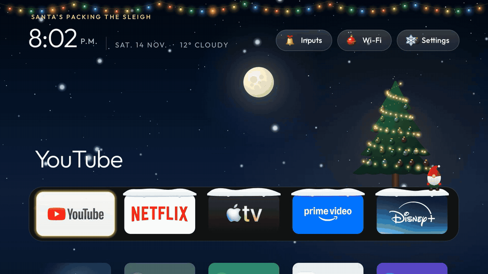

It runs on [CleanYourTV](https://github.com/Gathin23/cleanyourtv)'s TV Home, an open-source launcher that makes an Android TV look a lot like an Apple TV: your apps in a dock, no ads, no sponsored rows. I made the Christmas season, the screensaver and a few [Home Assistant pieces](#home-assistant) for the TV in our living room (a Sony Bravia on Google TV), and figured other people might like them too.

[Install](#install) · [What happens when](#what-happens-when) · [The screensaver](#the-screensaver) · [Home Assistant](docs/home-assistant.md) · [Which TVs](#which-tvs-it-works-on) · [Make it yours](#make-it-yours)

## What happens when

From mid-November the greeting at the top of Home counts down ("41 sleeps to Christmas"), snow drifts down a night sky, fairy lights hang along the top of the screen, and the apps in the dock get little caps of snow.

The first time you open Home each day, a short moment plays: a snow flurry, a shooting star, the fairy lights chasing each other, one giant snowflake, Santa's sleigh, a cardinal landing on the dock, or the northern lights. Any button ends it straight away, so it never stands between you and whatever you were about to watch.

Special days add something on top of that, and most of what arrives stays until New Year's:

| Date | What changes |
|---|---|
| 14 Nov | The lights go up. |
| 24 Nov | Full moon, and the sleigh flies past it. |
| 29 Nov | Advent Sunday. A Christmas tree arrives next to the dock and stays. |
| 1 Dec | A gnome moves in. He hides somewhere new every day: on an app tile, on top of one of the buttons, next to the date, by the tree, or peeking out from the end of the dock. |
| 1 to 24 Dec | One more ornament on the tree every day, Advent-calendar style. The day's ornament drops onto the tree when you first open Home. |
| 13 and 14 Dec | The Geminids: shooting stars. |
| 18 Dec | Ugly Sweater Day. The buttons get knitted sweaters and the lights go multicolour. |
| 21 Dec | The longest night, with the northern lights. |
| 24 Dec | Christmas Eve. A star on top of the tree, and all day the greeting tracks Santa around the world, until he's nearly at your place. |
| 25 Dec | Presents under the tree. |
| 26 to 31 Dec | Boxing Day, then a countdown to 2027 while the gnome sleeps it off. |
| 1 Jan | Fireworks. On the 2nd, Home goes back to its usual look by itself. |

| | |
|---|---|
| 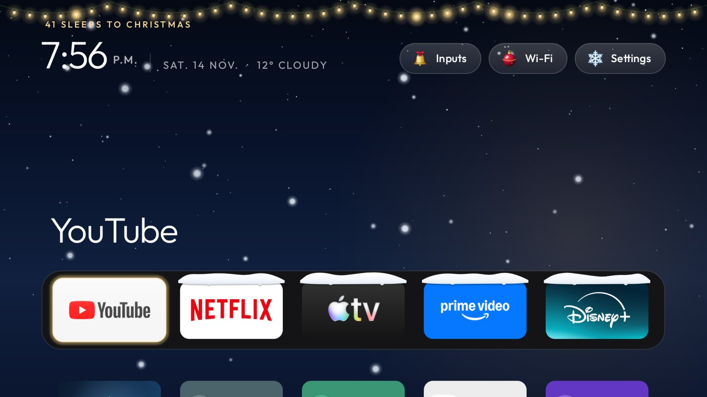 | 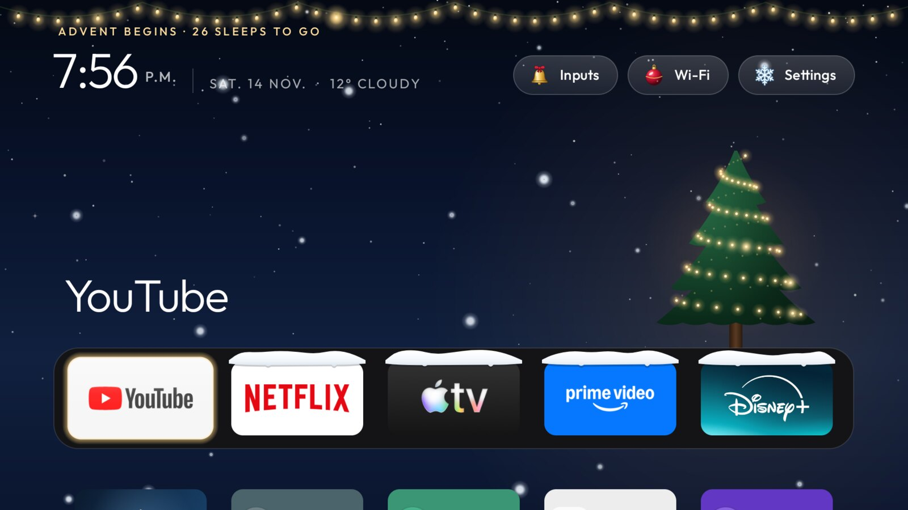 |
| Mid-November: the lights are up | 29 Nov: the tree arrives |
| 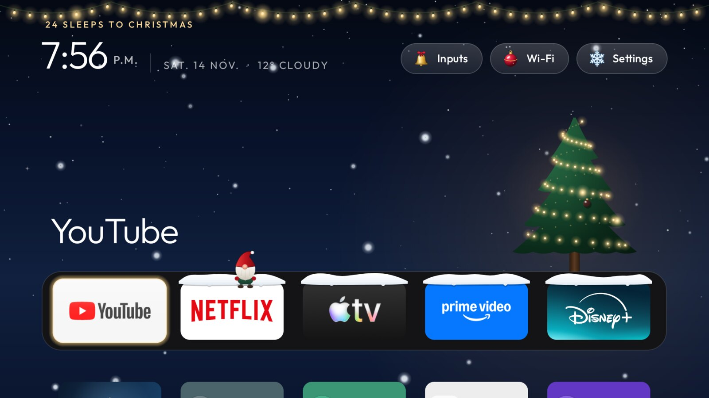 | 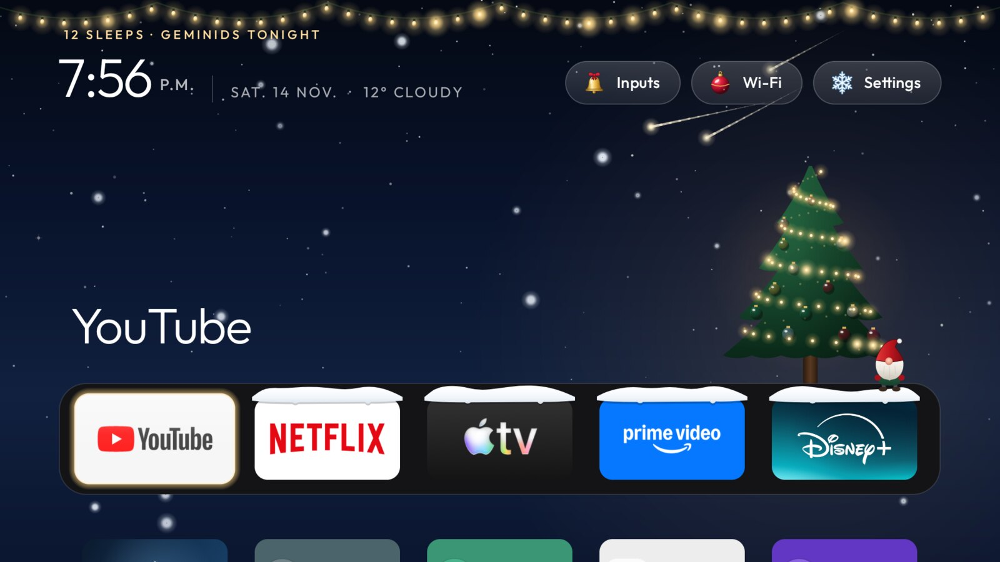 |
| 1 Dec: the gnome moves in (today he's on Netflix) | 13 Dec: Geminids night |
| 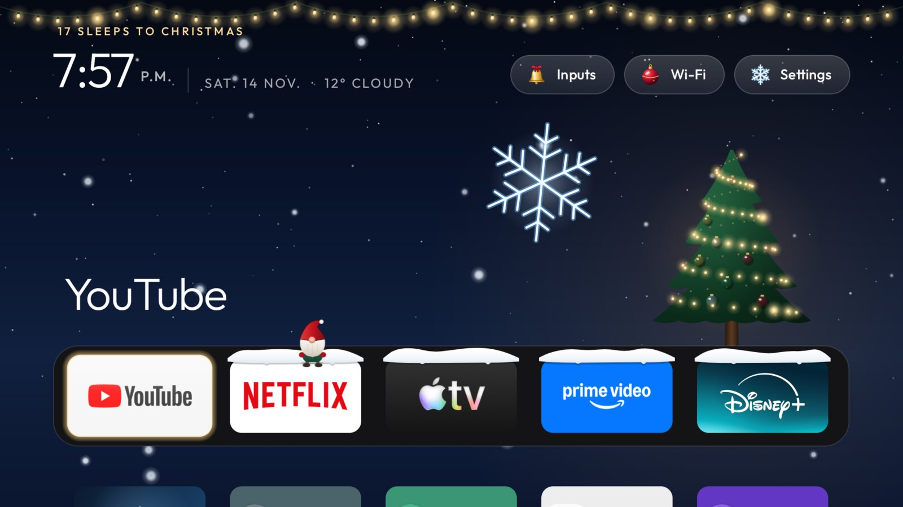 | 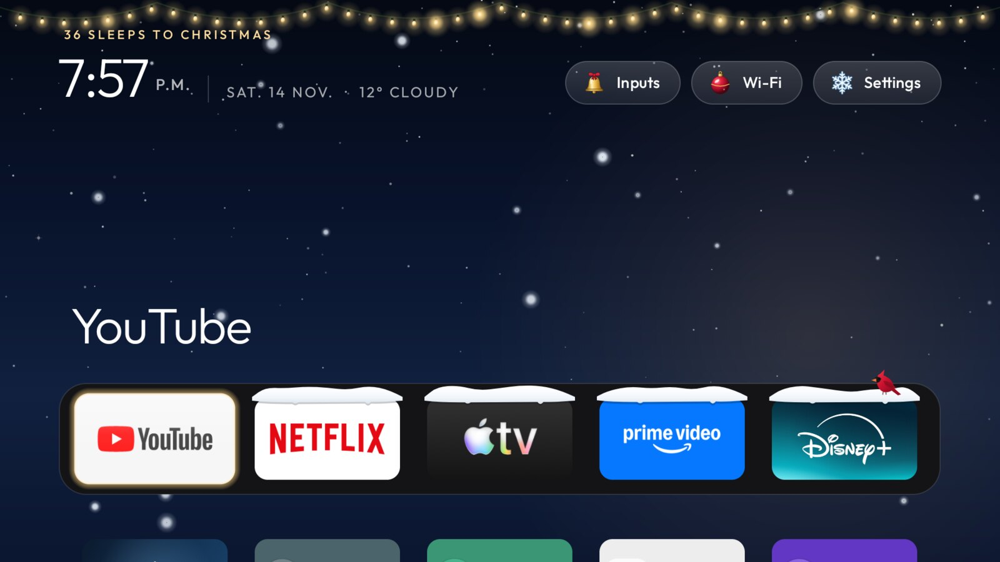 |
| A giant snowflake drifts by | A cardinal lands on the dock |
| 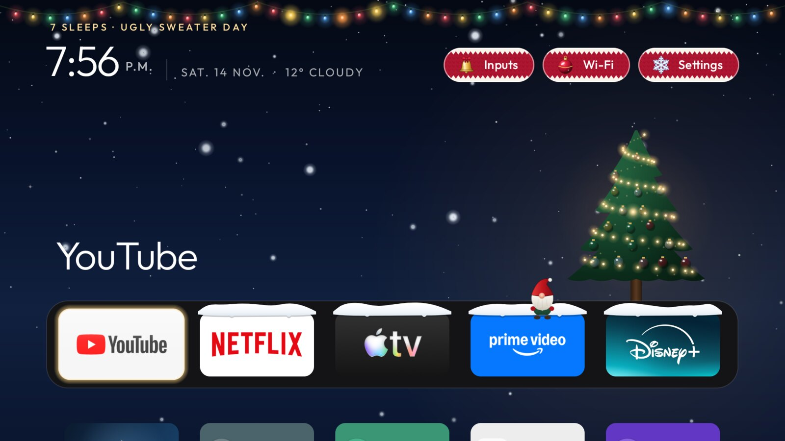 | 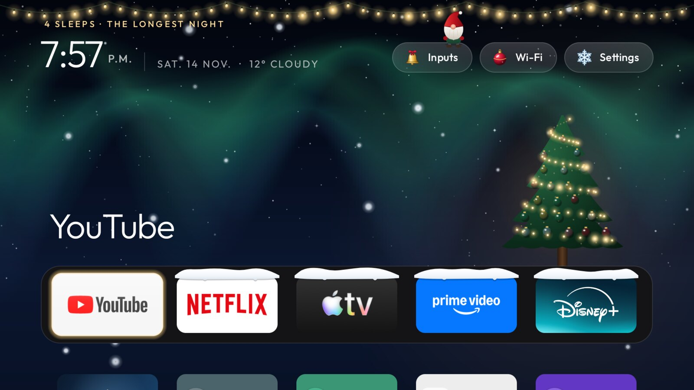 |
| 18 Dec: Ugly Sweater Day | 21 Dec: the longest night |
| 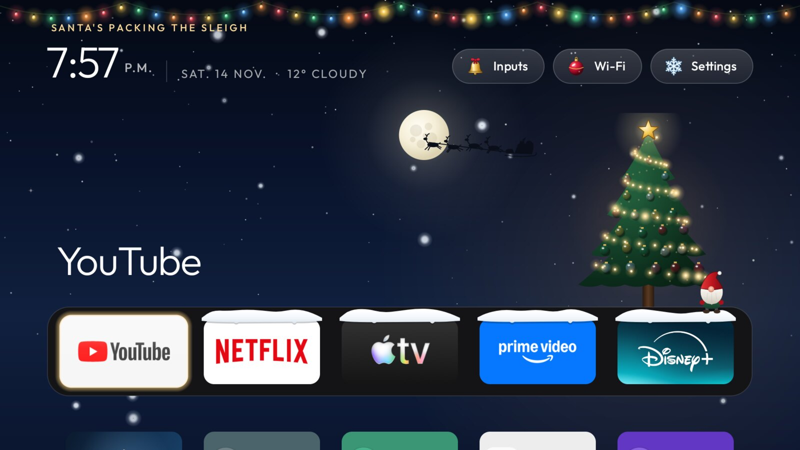 | 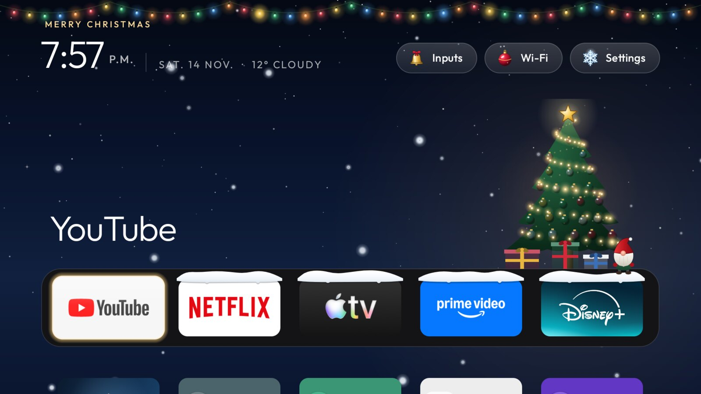 |
| 24 Dec: "Santa's packing the sleigh" | 25 Dec: presents |
| 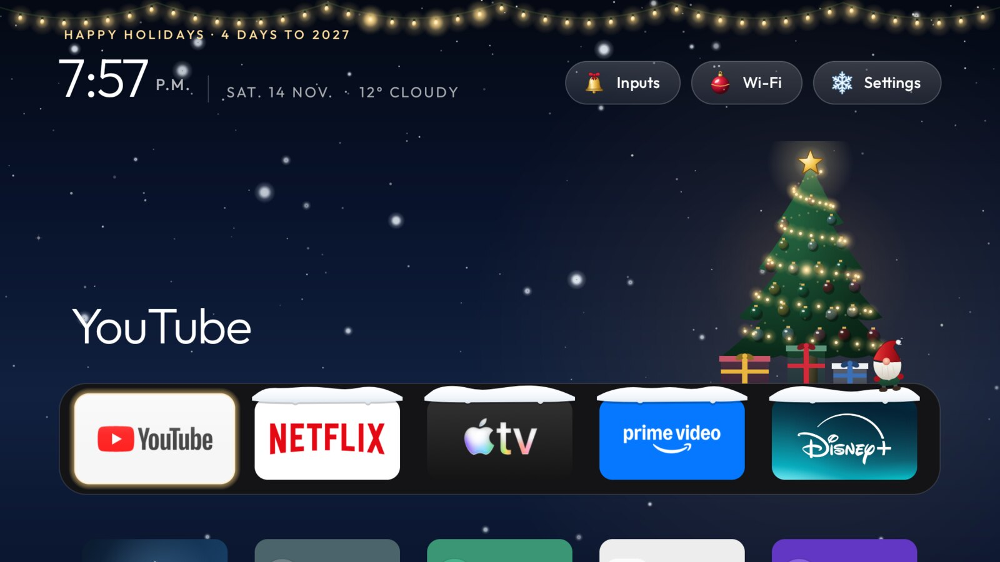 | 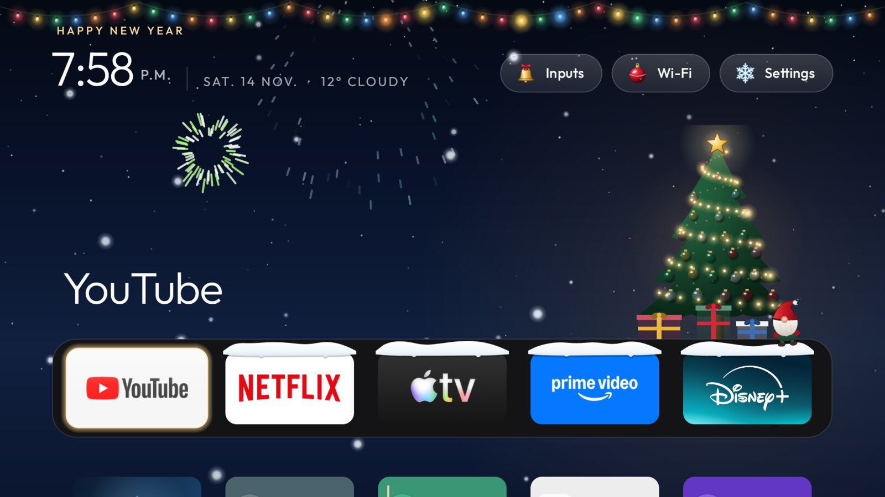 |
| Between Christmas and New Year's | 1 Jan: fireworks |

All of these were taken on my TV on 14 November using the theme's preview setting to jump to each day, which is why the date line says 14 Nov.

## The screensaver

When the TV sits idle, the screensaver plays a fireplace with the sound off. Every few minutes it moves on to the tree, a snowy moonlit forest or a close-up of ornaments, then back to the fire. Each clip dissolves into the next, so you never see a loop restart. In the corner you get the countdown, a line on special days ("Santa sets off tonight."), the time, and the date with the weather.

| | |
|---|---|
| 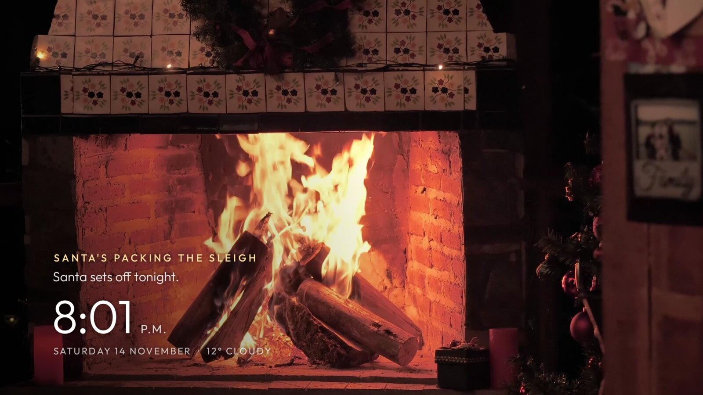 | 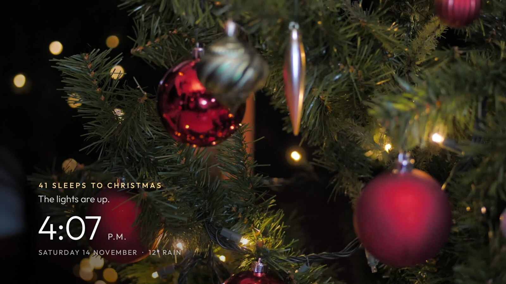 |

The videos are free clips from [Mixkit](https://mixkit.co). They aren't stored in this repo: `./install.sh <TV> clips` downloads them from Mixkit and copies them to the TV, or you can use your own. On my TV the screensaver uses about 10% of the CPU.

## Home Assistant

If you run Home Assistant, the TV can join in. There are three optional extras; each works without the others, and all three stay after the Christmas season packs itself away. Setup for each is in [docs/home-assistant.md](docs/home-assistant.md).

- A Smart Home dashboard you drive with the remote. Scenes, lights, plugs, the thermostat, sensors, doors and locks are tiles, with the weather and who's home along the top and a Front door tile that says when the doorbell last rang. OK switches a light or runs a scene. Hold OK on a light and Left and Right dim it (on the thermostat they set the temperature). Locks are shown but never unlocked from the remote.
- "Someone's at the door" pop-ups over whatever is playing. If the screensaver is on, it closes and the pop-up shows over Home.
- The weather from Home Assistant on the date line, on Home and on the screensaver. TV Home has no internet permission, so a small script on your network pushes it in.

| | |
|---|---|
| 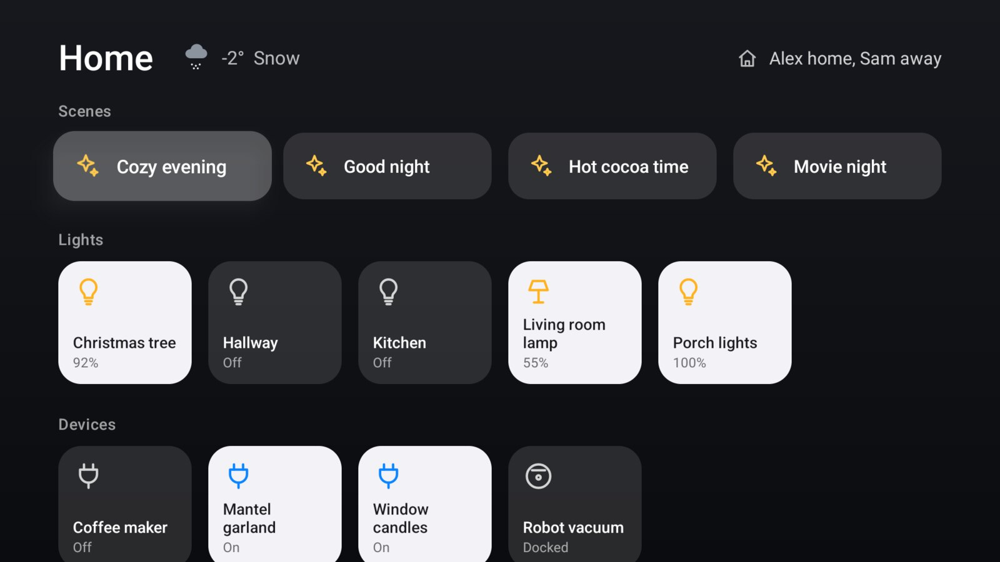 | 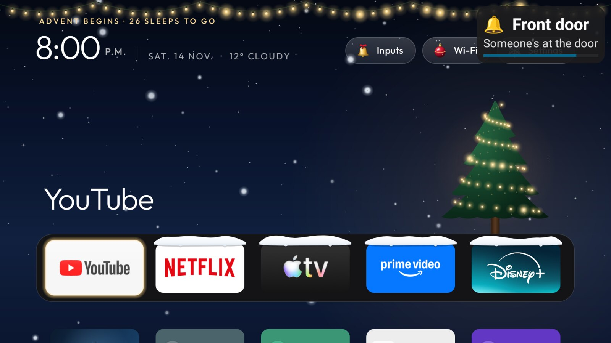 |
| The dashboard, driven with the remote | Someone's at the door |

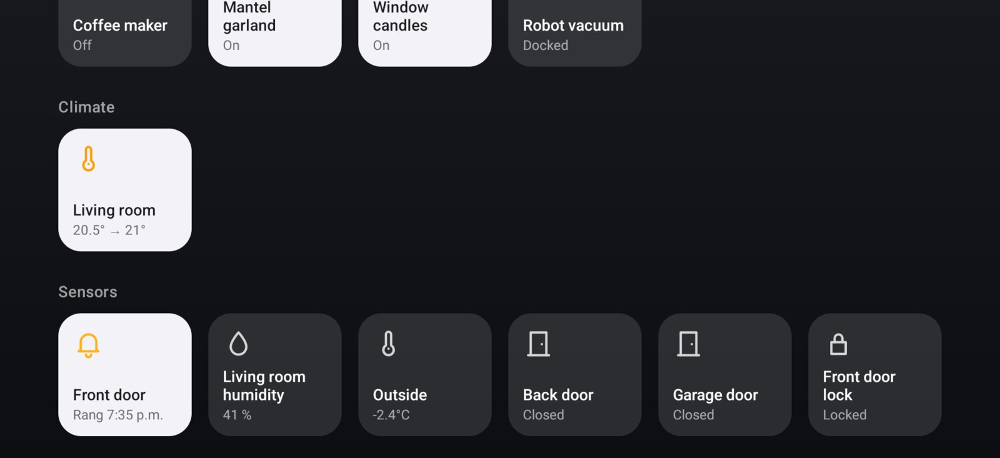

(These come from a stand-in Home Assistant with a made-up house.)

## Install

You need a TV or streaming box on Android TV or Google TV with Android 8 or newer (see [Which TVs](#which-tvs-it-works-on)), and a computer on the same network with adb, which comes in Android's [platform-tools](https://developer.android.com/tools/releases/platform-tools).

On the TV, switch on developer options: Settings > System > About, then press OK on "Android TV OS build" seven times (on older Android TV it's Settings > Device Preferences > About > Build). In the new Developer options menu, turn on USB debugging, and Network debugging if your TV has that switch.

Most TVs then answer on port 5555. Newer ones (a Google TV Streamer on Wi-Fi, a Chromecast with Google TV on Android 14) use Wireless debugging instead: in Developer options open Wireless debugging > Pair device with pairing code, run `adb pair <the IP:port it shows> <the code>`, and then use the IP:port from the main Wireless debugging screen wherever this page says the TV's address, for example `./install.sh 192.168.1.50:41235`.

### Mac or Linux

```bash
git clone https://github.com/hikhetarpal88/christmas-tv-home
cd christmas-tv-home
./install.sh 192.168.1.50          # your TV's IP address
./install.sh 192.168.1.50 clips    # the screensaver videos (about 190 MB)
./install.sh 192.168.1.50 home     # optional: make it your Home screen
```

The first time, the TV asks "Allow USB debugging?". Tick Always allow and press OK.

The first command installs `christmas-tv-home.apk` from the [latest release](https://github.com/hikhetarpal88/christmas-tv-home/releases/latest) (checked against its SHA256SUMS), loads the Christmas theme and switches the screensaver to the fireplace. It remembers your old screensaver: `./install.sh <TV> old-screensaver` puts it back.

The screensaver starts after the TV's usual idle time. To change it, use the TV's screensaver or ambient mode settings, or set it in milliseconds with `adb shell settings put system screen_off_timeout 600000` (ten minutes; newer Google TVs won't go below six). Inside the YouTube app you'll still get YouTube's own screensaver, because the app runs its own.

### Windows, or by hand

Download `christmas-tv-home.apk` from the [latest release](https://github.com/hikhetarpal88/christmas-tv-home/releases/latest) and this repo (Code > Download ZIP), then from that folder:

```bat
adb connect 192.168.1.50:5555
adb install -r christmas-tv-home.apk
adb push theme\christmas\config.json /data/local/tmp/christmas.json
adb shell "content write --uri content://com.gathin.tvhome.theme/config.json < /data/local/tmp/christmas.json"
adb shell am force-stop com.gathin.tvhome
adb shell settings put secure screensaver_components com.gathin.tvhome/.HolidayDream
```

For the videos, download the four clips from Mixkit (links under [Credits](#credits)), then for each one:

```bat
adb push 1-fireplace.mp4 /data/local/tmp/1-fireplace.mp4
adb shell "content write --uri content://com.gathin.tvhome.theme/holiday/1-fireplace.mp4 < /data/local/tmp/1-fireplace.mp4"
adb shell rm /data/local/tmp/1-fireplace.mp4
```

On Android 8 or 9 there's no `content write`. Push the files straight into TV Home's folder there instead: `adb push theme\christmas\config.json /sdcard/Android/data/com.gathin.tvhome/files/config.json`, and the clips into `/sdcard/Android/data/com.gathin.tvhome/files/holiday/`.

The clip with "fireplace" in its name is the main scene. File names can only use letters, numbers, dots, dashes and underscores.

### Making it your Home screen

Installing the app doesn't change what your Home button opens. The screensaver works either way, but the Christmas home screen only shows once TV Home is your Home screen.

Google TV has no setting for a different home app, so `./install.sh <TV> home` switches the Google TV home off. Nothing is uninstalled, and `./install.sh <TV> undo-home` switches it back on. It also switches off Google TV's setup app, because otherwise the Home button can land on that app's recovery screen instead of TV Home. On plain Android TV (Nvidia Shield, Mi Box and the like) it switches off the Android TV home instead.

There's one trap, and the script checks for it first. If your Wi-Fi network was saved while you set the TV up, it belongs to that setup app, and Android deletes it when the app is switched off: the TV drops off Wi-Fi. If that's the case, the script stops and asks you to forget the network in Settings and join it again with the remote (or to plug in Ethernet), then run it again.

By hand, check with `adb shell dumpsys wifi` and look for `cname=com.google.android.tungsten.setupwraith`. If it isn't there (or you've re-joined the network):

```bat
adb shell pm disable-user --user 0 com.google.android.tungsten.setupwraith
adb shell pm disable-user --user 0 com.google.android.apps.tv.launcherx
```

To undo it, switch them back on:

```bat
adb shell pm enable com.google.android.apps.tv.launcherx
adb shell pm enable com.google.android.tungsten.setupwraith
```

With the Google TV home switched off:

- Google TV profiles stop working, because the profile picker lives inside the Google TV home
- on some TVs the remote's settings (gear) button stops opening quick settings; use the Settings button on Home
- the remote's YouTube and Netflix buttons keep working on some devices and not on others
- on a Chromecast with Google TV or a Google TV Streamer, switching the setup app off also stops casting from your phone
- switch both back on before a factory reset, because the setup wizard needs them

If you want the full treatment (removing the TV's ads and bloat, keeping the remote's Input and YouTube buttons working, a backup and a one-line restore), CleanYourTV's own [installer](https://github.com/Gathin23/cleanyourtv#quick-start) does all of that. If you go that way, build this repo afterwards (next section) so the Christmas version installs over it.

### Already running CleanYourTV?

This is built on CleanYourTV 3.0, and your copy of TV Home is signed with your own key, so the release APK won't install over it. If you're still on 3.0, build this repo with `./build.sh`, which signs with the same `~/.android` key your CleanYourTV build used. On 3.1 or newer that won't work, because Android won't put an older version over a newer one, even one you built yourself. Uninstall yours first (`adb uninstall com.gathin.tvhome`) and install this one straight after, since the TV may have no Home screen in between. The Smart Home add-on here is from 3.4; if yours is newer, uninstall it first too. Uninstalling clears TV Home's settings, and loading the Christmas theme replaces whatever theme you had, so push yours again after New Year's.

CleanYourTV 3.4 added a `christmas` theme of its own: a still wallpaper of a snowy night with Santa's sleigh. This is a separate thing, a season that changes every day. That takes launcher code, which is why it comes as its own build of TV Home.

## Which TVs it works on

| Device | What works |
|---|---|
| Google TV: Chromecast with Google TV, Google TV Streamer, onn 4K, Xiaomi TV Box S (2nd and 3rd gen), and TVs from Sony, TCL, Hisense, Philips and others | Everything. Tested on a Sony Bravia XR-75X90L (Google TV, Android 12). Other people have switched the Google TV home off the same way on a Chromecast with Google TV on Android 14 and on Philips sets; I haven't seen a report from a Google TV Streamer yet. |
| Android TV: Nvidia Shield, the original Xiaomi Mi Box S, older Android TV sets | Everything, though I haven't tried one myself. On a Shield you can even pick the screensaver in Settings > Device Preferences > Screen saver. |
| Fire TV on Fire OS 7 or 8 (Fire TV Stick 4K Max, the 2023 Fire TV Stick 4K, the Fire TV Cube, Fire TV sets) | The app installs, but not as your home screen: Amazon has blocked replacing its launcher since 2023. The screensaver can be set over adb, but on Fire OS 8.1 and later Amazon tends to switch its own back. Untested. |
| Older Fire TVs (Fire OS 5 or 6, like the 2018 Fire TV Stick 4K) | Nothing. Their Android is too old for TV Home (it needs Android 8). |
| Fire TV on Vega OS (Fire TV Stick 4K Select, the 2026 Fire TV Stick HD and 3rd-gen Fire TV Stick 4K) | Nothing. Vega OS doesn't run Android apps at all. |
| Roku | Nothing. Roku OS doesn't run Android apps, its home screen can't be replaced, and Roku screensavers aren't allowed to play video, so even the fireplace can't move over as it is. |
| Apple TV, Samsung (Tizen), LG (webOS) | Nothing. None of them lets another app be the home screen, or adds a screensaver like this one. |

It's only been tested on one TV so far. If you try it on something else, an issue saying how it went (good or bad) helps the next person.

## Make it yours

- The whole season is in [`theme/christmas/make-config.py`](theme/christmas/make-config.py): the greetings, which moment plays on which day, where the gnome hides, the sky, the lights, and the screensaver's line for special days. Edit it, run `python3 theme/christmas/make-config.py`, then `./install.sh <TV> theme`.
- To see a particular day now, `python3 theme/christmas/make-config.py --preview 2026-12-24 --moment sleigh@0.5 -o preview.json` makes a copy that shows Christmas Eve now, with the sleigh held still halfway across. Load it with `./install.sh <TV> theme preview.json`, and run `./install.sh <TV> theme` to go back.
- For your own videos, put `.mp4` files in a `clips` folder here and run `./install.sh <TV> clips`. Put "fireplace" in the name of the one you want as the main scene.
- To change the dock, hold OK on the Settings button: Edit dock chooses and orders the apps, and Launcher settings has Apps per row. A theme can set both too (`dock_apps`, `columns`).
- If your TV stutters, turn off Animations in Launcher settings. The snow, twinkling and daily moments stop and the scene stays still.
- It's written from the northern hemisphere (snow, the longest night on 21 December). The lines and moments are all in `make-config.py` if you want to change that.

## Build it yourself

```bash
./build.sh
```

You need git, curl and Docker. The first build takes about ten minutes while it downloads the Android SDK into a Docker volume; after that it's a couple of minutes. The APKs land in `dist/`, signed with the Android debug key in `~/.android`.

`build.sh` clones CleanYourTV at the release each patch was written for (v3.0.0 for the launcher, v3.4.0 for the Smart Home add-on), checks the tag still points at the same commit and that Gradle's wrapper matches its published checksum, applies the patches and builds in a throwaway container.

| Patch | What it adds |
|---|---|
| `launcher/patches/0001-weather-on-date-line.patch` | the weather after the date, read from a TV setting |
| `launcher/patches/0002-festivals-and-diwali.patch` | day-by-day greetings and decorations for festivals (it started with Diwali, which is still in there) |
| `launcher/patches/0003-christmas-season.patch` | everything Christmas on the home screen |
| `launcher/patches/0004-christmas-screensaver.patch` | the screensaver, and clips copied in through TV Home's file provider |
| `smart-home/patches/0001-exclude-scripts-vacuum.patch` | `exclude` patterns, scripts, the robot vacuum |
| `smart-home/patches/0002-dashboard-and-header.patch` | the tile dashboard, who's home, the doorbell tile |

## Privacy

TV Home has no internet permission. It can't phone home and doesn't try: no analytics, no update checks, and the weather comes in from your own network. The Smart Home add-on's only permission is the internet one, which it uses to reach the Home Assistant address you give it and nothing else.

## Credits

- [CleanYourTV](https://github.com/Gathin23/cleanyourtv) by Gathin: the TV Home launcher, and the Smart Home add-on by maxhayim. Both MIT.
- The [Outfit](https://fonts.google.com/specimen/Outfit) typeface, SIL Open Font License, which ships inside TV Home.
- The screensaver clips are from Mixkit under the [Mixkit license](https://mixkit.co/license/): [fireplace](https://mixkit.co/free-stock-video/a-fireplace-lit-at-christmas-time-2707/), [tree with ornaments](https://mixkit.co/free-stock-video/christmas-tree-with-ornaments-2710/), [moon over a snowy forest](https://mixkit.co/free-stock-video/moon-in-the-sky-a-snowy-forest-3350/), [tree close-up](https://mixkit.co/free-stock-video/close-view-of-a-christmas-tree-44579/). They're downloaded from Mixkit, never redistributed here.
- [PiPup](https://github.com/mhoogenbosch/PiPup) for the pop-ups.
- Most of the code was written with Claude Code; I decided what goes on screen and tested it on our TV.

## License

MIT, like CleanYourTV. See [LICENSE](LICENSE).
