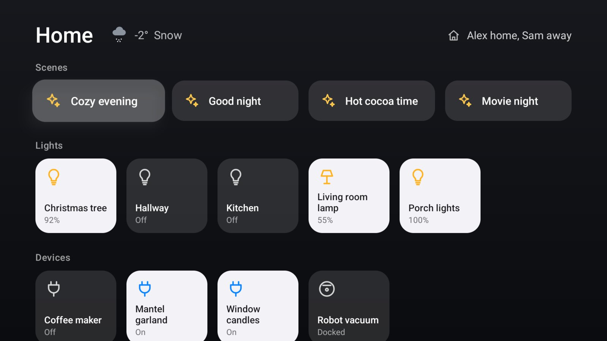
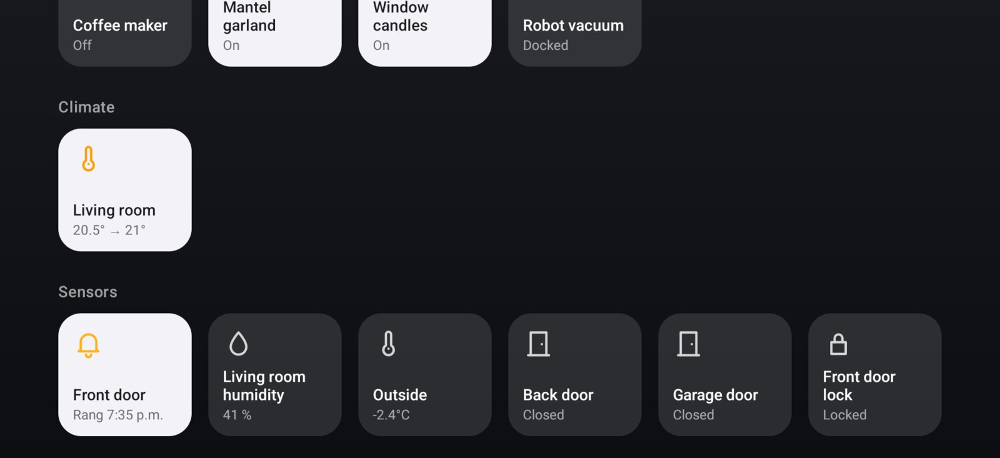
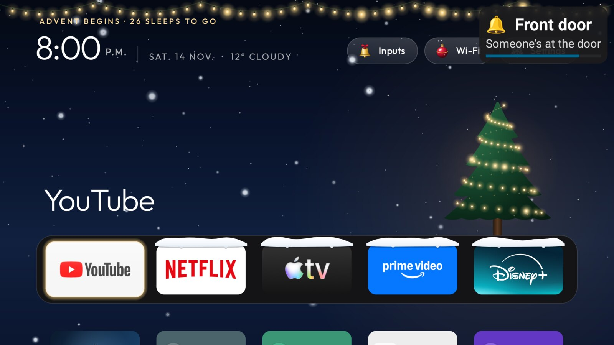

# Home Assistant on the TV

Three optional pieces. You can use any of them without the others, and none of them needs anything installed inside Home Assistant beyond a token and a couple of YAML snippets.

| | What you get | What it takes |
|---|---|---|
| [Weather on the date line](#weather-on-the-date-line) | `SAT. 14 NOV. · 12° CLOUDY` on Home and on the screensaver | a small script on any always-on machine with adb |
| [Smart Home dashboard](#smart-home-dashboard) | your lights, plugs, scenes and sensors as tiles, plus who's home and when the doorbell last rang | the Smart Home add-on and a token |
| [Doorbell pop-ups](#doorbell-pop-ups) | "Someone's at the door" over whatever is playing | PiPup on the TV and one automation |

The screenshots on this page come from a stand-in Home Assistant with a made-up house (Alex, Sam, a mantel garland), so nothing here is anyone's real home.

## Weather on the date line

TV Home has no internet permission, so it can't look the weather up itself. Instead, something on your network writes it into a TV setting over adb every few minutes, and TV Home shows it after the date (the screensaver does too). A reading older than three hours is hidden, so if the push stops, the weather quietly disappears instead of going stale.

[`home-assistant/push-weather.sh`](../home-assistant/push-weather.sh) reads a weather entity from Home Assistant's REST API and pushes it. Any Linux box, Mac or Raspberry Pi that is always on and has `adb` and `curl` will do:

```bash
echo 'your-long-lived-token' > ~/.ha-token && chmod 600 ~/.ha-token
HA_URL=http://192.168.1.10:8123 HA_TOKEN_FILE=~/.ha-token TV=192.168.1.50 ./home-assistant/push-weather.sh
```

Then run it every 10 minutes from cron (`crontab -e`):

```
*/10 * * * * HA_URL=http://192.168.1.10:8123 HA_TOKEN_FILE=/home/you/.ha-token TV=192.168.1.50 /path/to/push-weather.sh
```

That's what runs at my place. The setting is plain text, so anything that can run adb can write it. Try it by hand:

```bash
adb shell settings put global bravia_weather "$(date +%s)|-3° Snow"
```

If you already use Home Assistant's [Android Debug Bridge integration](https://www.home-assistant.io/integrations/androidtv/) with your TV, an automation can do the same job without the script. I haven't run this version myself, so treat it as a starting point:

```yaml
alias: "TV: weather on the date line"
triggers:
  - trigger: state
    entity_id: weather.forecast_home
  - trigger: time_pattern
    minutes: "/30"
actions:
  - action: androidtv.adb_command
    target:
      entity_id: media_player.living_room_tv   # the TV's Android Debug Bridge entity
    data:
      command: >-
        
        
        settings put global bravia_weather '{{ now().timestamp() | int }}|{{ state_attr('weather.forecast_home', 'temperature') | round(0) | int }}° {{ words.get(w, w) }}'
```

## Smart Home dashboard



This is CleanYourTV's [Smart Home add-on](https://github.com/Gathin23/cleanyourtv/tree/main/addons/smart-home) with two patches from this repo:

- the list becomes Apple Home-style tiles: scenes, lights, plugs and switches, climate, sensors, doors and locks
- the header shows the weather and who's home ("Alex home, Sam away", from your `person` entities)
- a Front door tile says when the doorbell last rang (it reads the last run of your doorbell automation, below)
- scripts show up as one-press rows next to scenes, a robot vacuum is a tile that starts it or sends it back to the dock, and scenes that have never run can still be run
- `exclude` patterns hide entities you don't want on the TV, like the dozens of segment lights some LED strips add

With the remote: OK runs a scene or switches a light or plug. Hold OK on a light and Left and Right dim it (on a thermostat they set the temperature); OK again when you're done. Locks are shown but never unlocked from the remote.



To set it up, make a long-lived access token (Home Assistant > your profile > Security > Long-lived access tokens), copy [`home-assistant/smart-home.example.json`](../home-assistant/smart-home.example.json) somewhere outside this folder, fill in your address and the token, and run:

```bash
./install.sh 192.168.1.50 smart-home ~/smart-home.json
```

That installs the add-on and hands it the file through a provider only adb can write to, so the token is never typed on the TV or put on a command line. The keys:

| Key | What it does |
|---|---|
| `url`, `token` | your Home Assistant address (use the IP if `homeassistant.local` doesn't resolve on the TV) and the token |
| `glance` | the weather entity for the header |
| `exclude` | entity ids to leave out; `*` matches anything, so `light.*_segment_*` drops every segment light |
| `summary.doorbell` | the doorbell automation whose last run counts as the last ring |

Press Home afterwards: TV Home asks once whether to show the add-on's card, and from then on a Smart Home tile opens the dashboard. The add-on's only permission is the internet one, and it only ever talks to the address you gave it.

## Doorbell pop-ups



[PiPup](https://github.com/mhoogenbosch/PiPup) is a small Android TV app that shows a notification over whatever is on screen when something on your network asks it to. If the screensaver is running when a pop-up arrives, the screensaver closes and the pop-up shows over Home. Install it from its releases page and give it permission to draw over other apps:

```bash
adb install PiPup.apk
adb shell appops set nl.rogro82.pipup SYSTEM_ALERT_WINDOW allow
adb shell am start-foreground-service -n nl.rogro82.pipup/.PiPupService
```

To check it works, send a test pop-up from your computer:

```bash
curl -X POST http://192.168.1.50:7979/notify -H 'Content-Type: application/json' \
  -d '{"title": "Hello", "message": "From my laptop", "duration": 10}'
```

Once that shows up on the TV, two things go into Home Assistant.

1. Add the two REST commands from [`home-assistant/tv-popups.yaml`](../home-assistant/tv-popups.yaml) to `configuration.yaml` (with your TV's address) and restart.
2. Create the automation in [`home-assistant/doorbell-popup.yaml`](../home-assistant/doorbell-popup.yaml) and point its trigger at your doorbell. The file covers doorbells that show up as a binary sensor, as an event entity, or only in Apple Home (the trick I use: an Apple Home automation flips a helper toggle that HomeKit Bridge shares with Home Assistant).

The same `rest_command.tv_popup` works for anything else you want on the TV: the washer finishing, a garage door left open, or a camera snapshot (PiPup can show images and RTSP streams; see its README for the fields).
